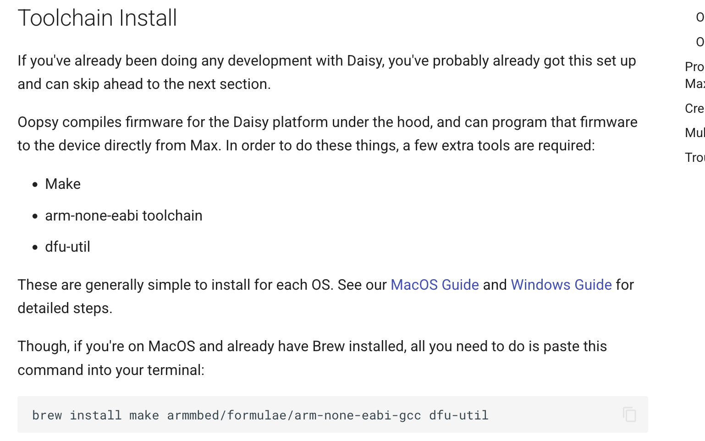

# RamaPeddles
Open-Source Effect Pedals.  
Started as an NYU Tandon USRP 2021.
Continued at Ramapo College of New Jersey in 2025, going strong in 2026

____
Here is our daisy resource page.    

https://docs.daisy.audio/tutorials/oopsy-dev-env/
look at this page carefully.

1) the first thing you'll need to do is install the daisy toolchain.

once you have that installed, download the oopsy package.

for oopsy, in case you have problems, see below:
<b>
actually this might be the most recent release for oopsy!!! make sure you install here.
https://forum.electro-smith.com/t/oopsy-update-prerelease-want-to-try-the-new-features-early/3456
</b>

https://github.com/Cycling74/oopsy/

Go here to install the toolchain and the oopsy package. first you install the toolchain (for flashing code)
(and next you install the oopsy package, for dumping code via MAX)

This guide can be dissected into just a few parts:

1) Installing the toolchain for your OS (MacOS or Windows)
2)  Downloading the Oopsy package and placing it in your Max 8/Packages folder
3)    Opening up one of the example patches and programming your Daisy

Oopsy compiles firmware for the Daisy platform under the hood, and can program that firmware to the device directly from Max. In order to do these things, a few extra tools are required:

    Make
    arm-none-eabi toolchain
    dfu-util

These are generally simple to install for each OS. See the MacOS Guide and Windows Guide for detailed steps.

Though, if you're on MacOS and already have Brew installed, all you need to do is paste this command into your terminal:

brew install make armmbed/formulae/arm-none-eabi-gcc dfu-util

<b>anyway....</b>

now you've done those things its time to flash code.

1) open up max. open up the test patch in the "peddles_funbox" folder.

3) select which daisy jeson file you'll use for code. we're using the FunBox.json currently in 2026.

4) connect daisy to computer with usb cable

5) hold down the boot button and hit the reset button on the daisy. after releasing reset button you can release the boot button. It's kind of like a paradiddle, doesn't matter if you get it backwards, you can jam it multiple times.
(allows accessory to connect) 

6) now press the big BANG button in max and the oopsy objct will convert your gen patcher to C++ and dump it on the daisy. this actually happens every time you save!

7) enjoy..

[https://electro-smith.com/](https://electro-smith.com/)

the main page of the oopsy project
