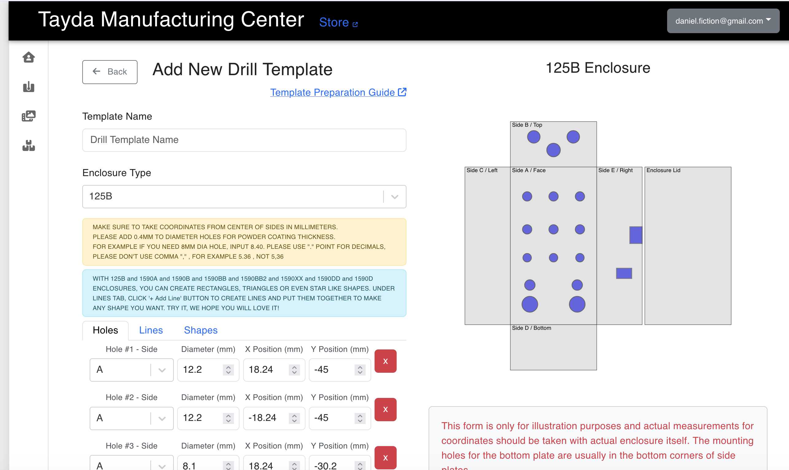
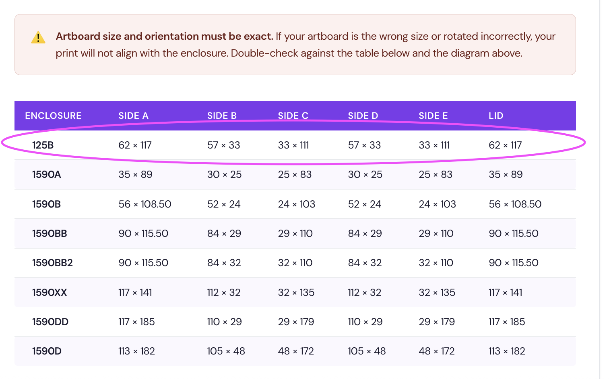

# RamaPeddles
Printing and drilling the templates for the funbox layout should be pretty straightforward... but it is not!

https://www.taydaelectronics.com/enclosure-modification-ordering-guide-v1

ostensibly all the information is here.
if you follow this guide, read, watch videos, all should work out.

but there a few things you will need to make sense of this guide:

1) you need to create an account on Tayda Box Tool using the same email as your Tayda Electronics account.

2) you'll also need a drill template.
these links i'll send don't work unless you login/make an account here:
https://drill.taydakits.com
so make sure you do that and then click this link again.
https://drill.taydakits.com/box-designs/new?public_key=M3BDZTdRSmFWRkF4QXpQUzRORjIwQT09Cg==
this drill template is exactly what we need.
https://drill.taydakits.com/box-designs/new?public_key=cmNGZE9RTXhWN2VxMW1tTW4xQ2ZQUT09Cg==
this drill template actually uses a slightly bigger hole for the 9v jack. I'll check and figure 
out which one we need.

the page should look like this

but you need to save it to your account.

3)the next part is the UV printing art, which you'll need to <b>carefully</b> follow the guide from tayda, converting your art to SVG, obeying the right color profile, etc...

https://www.taydaelectronics.com/uv-printing-service-guide-v1
this page is extremely comprehensive so I won't go too deep into making little excerpts here.
You can use Adobe Illustrator or Canva Affinity (free)

4) check the pdf of the exported UV art 
https://pdf.tayda.com/
(username: pdfman / password: pdfman) to check your file for errors before submitting.
Upload your pdf (exported CMYK vectors from illustrator or affinity)
you should make sure you use the funbox drill template in the pdf viewer:
<a href="36706_125B_funbox-drill-template.txt"> 36706_125B_funbox-drill-template.txt</a>

5) after you've checked the graphics and the holes, you "box them up"
https://www.taydaelectronics.com/enclosure-modification-ordering-guide-v1
using the Tayda Box Tool.
This part is pretty easy! 